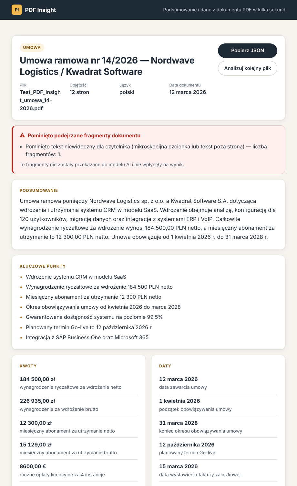

# PDF Insight

Aplikacja webowa, która wczytuje plik PDF, tworzy jego krótkie podsumowanie i zamienia treść
w uporządkowane dane JSON (zadanie rekrutacyjne — Vibe Coder).

**Demo:** https://sebastiangawlinski.github.io/pdf-insight/



## Co potrafi

| ID   | Wymaganie                                                           | Status                 |
| ---- | ------------------------------------------------------------------- | ---------------------- |
| F-01 | Wgrywanie PDF: drag & drop i wybór pliku, tylko PDF, maks. 10 MB    | ✅                     |
| F-02 | Ekstrakcja tekstu z PDF z warstwą tekstową (pdf.js w przeglądarce)  | ✅                     |
| F-03 | Podsumowanie 3–5 zdań w języku dokumentu, bez zmyślonych informacji | ✅                     |
| F-04 | Dane zgodne ze schematem, walidowane (Zod) przed wyświetleniem      | ✅                     |
| F-05 | Czytelny widok wyników, podgląd JSON, pobranie pliku `.json`        | ✅                     |
| F-06 | Stany: ładowanie, błąd z opcją ponowienia, stan pusty               | ✅                     |
| F-07 | Publiczne demo na GitHub Pages                                      | ✅                     |
| F-08 | Długie dokumenty: podział na fragmenty i łączenie wyników           | ✅                     |
| F-09 | Historia ostatnich 5 analiz w `localStorage`                        | ✅                     |
| F-10 | OCR skanów                                                          | ❌ świadomie pominięte |

## Architektura

```
Przeglądarka (GitHub Pages)              Cloudflare Worker                     Modele AI
┌──────────────────────────────┐ tekst  ┌────────────────────────────┐     ┌───────────────────┐
│ walidacja pliku (PDF, 10 MB) │ ─────► │ CORS + kontrola Origin     │  1. │ Workers AI        │
│ pdf.js → tekst + l. stron    │        │ limit żądań na IP          │ ──► │ Gemma 4 26B       │
│ filtr ukrytego tekstu        │        │ wycinanie poleceń dla AI   │     ├───────────────────┤
│ Zod → widok → eksport .json  │ ◄───── │ pamięć podręczna (KV, 7 d) │  2. │ Groq gpt-oss-120b │
│ historia w localStorage      │  JSON  │ prompt, walidacja, 1 retry │  3. │ Groq gpt-oss-20b  │
└──────────────────────────────┘        │ grounding kwot i dat       │     └───────────────────┘
                                        └────────────────────────────┘
```

- **Frontend** — React 19 + TypeScript (strict) + Vite, hostowany na GitHub Pages
  (deploy przez GitHub Actions).
- **Backend** — Cloudflare Worker (`worker/`), jedyne miejsce, gdzie znajduje się klucz API.
- **AI** — łańcuch darmowych dostawców: **Cloudflare Workers AI** (`@cf/google/gemma-4-26b-a4b-it`,
  przez binding — bez klucza API), a gdy wyczerpie dzienny limit lub nie odpowiada — **Groq**
  (`openai/gpt-oss-120b`, potem `openai/gpt-oss-20b`; dowolne API zgodne z OpenAI Chat Completions).
- **Pamięć podręczna** — Cloudflare KV: ten sam dokument drugi raz = natychmiastowy wynik bez
  zużywania limitów AI.

### Struktura

```
src/
  api/          klient backendu (fetch + walidacja odpowiedzi)
  components/   komponenty React (dropzone, stany, wyniki, historia, podgląd JSON)
  lib/          schemat Zod, odczyt PDF, walidacja pliku, eksport, historia, formatowanie
worker/src/     Cloudflare Worker: routing, CORS, prompt, łańcuch dostawców AI, pamięć
                podręczna, normalizacja, dzielenie długich dokumentów, grounding,
                wykrywanie poleceń dla AI
.github/        GitHub Actions: lint › test › build › deploy
```

## Najważniejsze decyzje

1. **Tekst z PDF wyciąga przeglądarka (pdf.js), nie serwer.** Do backendu trafia tylko tekst —
   mniejszy transfer, szybsza odpowiedź, a sam plik nie opuszcza komputera użytkownika.
2. **Fakty znane aplikacji nie pochodzą od AI.** `fileName` i `pages` ustawia aplikacja;
   model generuje tylko to, czego nie da się policzyć deterministycznie.
3. **Jeden schemat dla frontendu i backendu** (`src/lib/schema.ts`). Worker waliduje odpowiedź
   modelu, frontend waliduje odpowiedź API przed wyświetleniem, testy sprawdzają ten sam schemat.
4. **Normalizacja przed walidacją.** Drobne, jednoznaczne usterki formatu (`"zł"` → `"PLN"`,
   `"12 500,00"` → `12500`, `"PL"` → `"pl"`) są poprawiane w kodzie; błędne wartości są usuwane
   (null / pominięcie), nigdy dopisywane.
5. **Ponowna próba zgodnie z briefem:** przy odpowiedzi niezgodnej ze schematem model dostaje
   swoją odpowiedź i listę błędów walidacji — jedna ponowna próba, potem komunikat błędu.
6. **Grounding w tekście źródłowym.** Każda kwota i data zwrócona przez model musi występować
   w tekście PDF — inaczej jest usuwana. To deterministyczna ochrona przed halucynacjami
   i skutkami prompt injection.
7. **Długie dokumenty (F-08):** tekst do 24 tys. znaków idzie w jednym zapytaniu; dłuższy jest
   dzielony na fragmenty (granice akapitów/zdań), analizowany równolegle, a wyniki łączone:
   listy deterministycznie (unie bez duplikatów, głosowanie typu/języka), podsumowanie —
   dodatkowym wywołaniem modelu.
8. **Łańcuch darmowych dostawców AI.** Każdy darmowy plan ma inne ograniczenie, więc Worker
   próbuje ich po kolei i przechodzi dalej przy wyczerpanym limicie, błędzie lub przekroczonym
   czasie. Limity się sumują, a demo działa dłużej bez opłat:
   - **Cloudflare Workers AI** — 10 tys. „neuronów” dziennie (ok. 80–90 analiz), połączenie przez
     binding, więc **nie ma klucza API, który mógłby wyciec**; dane nie są używane do trenowania;
   - **Groq** — szybki, ale darmowy plan ma 8 tys. tokenów na minutę, więc obsługuje tylko
     krótsze dokumenty (do ok. 10 tys. znaków); większych zapytań Worker tam nie wysyła wcale.

   Odrzucone: darmowy Gemini API (regulamin Google nie pozwala obsługiwać nim użytkowników
   z UE), darmowy Mistral (plan Free nie aktywuje kluczy API), SambaNova i OpenRouter
   (ok. 20–50 zapytań dziennie), Cerebras (wymaga karty).

9. **Model: Gemma 4 26B zamiast Llama 3.3 70B.** Llama 70B nie mieściła się w limicie czasu
   (analiza 12-stronicowej umowy przekraczała 25 s). Gemma 4 26B A4B to model MoE — w każdym kroku
   pracuje tylko ok. 4 mld parametrów — więc jest wyraźnie szybsza i kilkukrotnie tańsza w limicie
   dziennym. Dodatkowo: wyłączony tryb „myślenia” (`enable_thinking: false`; ewentualne „myśli”
   w odpowiedzi są wycinane przed odczytem JSON) i zwięzła odpowiedź (maks. 1,5 tys. tokenów,
   krótkie opisy, do 12 kwot i 10 dat). Analiza testowej umowy mieści się w wymaganych 30 s,
   a ponowna analiza tego samego dokumentu (pamięć podręczna) jest natychmiastowa.
10. **Pamięć podręczna wyników.** Kluczem jest skrót SHA-256 oczyszczonego tekstu i wersji promptu;
    wpis wygasa po 7 dniach. Najczęstszy scenariusz — wiele osób testuje ten sam przykładowy PDF —
    kosztuje jedno wywołanie modelu. Nazwa pliku i liczba stron nie są zapisywane.
11. **Brak routera.** Aplikacja ma jeden ekran ze stanami, więc problem routingu na GitHub Pages
    (HashRouter / 404.html) w ogóle nie występuje.

## Bezpieczeństwo

- Główny dostawca (Workers AI) działa przez binding — bez klucza API. Klucz dostawcy zapasowego
  (Groq) jest wyłącznie w sekretach Cloudflare (`wrangler secret put`) — nigdy we frontendzie
  ani w repozytorium (`.env`, `.dev.vars` są w `.gitignore`).
- CORS ograniczony do `https://sebastiangawlinski.github.io`; Worker dodatkowo sam sprawdza
  nagłówek `Origin` i odrzuca żądania z innych domen (403).
- Limit żądań: 6 analiz / minutę / IP (Cloudflare Rate Limiting). Limit rozmiaru: plik 10 MB
  (frontend), ciało żądania 2 MB, analizowane maks. 60 tys. znaków (Worker).
- **Prompt injection — ochrona warstwowa.** Zasada: bezpieczeństwo nie zależy od tego, czy model
  „posłucha”. Model nie ma żadnych uprawnień (nie wysyła maili, nie ma dostępu do danych), więc
  w najgorszym razie atak może zepsuć tekst wyniku — a kolejne warstwy to ograniczają:
  1. **Filtr niewidocznego tekstu** (przeglądarka) — tekst poza stroną albo wyraźnie mniejszy
     od reszty dokumentu (< 60% dominującej czcionki i < 6 pt) nie trafia do analizy. Próg jest
     względny, więc dokument w całości pisany drobnym drukiem (np. arkusz „dopasuj do strony”,
     4–5 pt) jest analizowany normalnie. Testowy PDF ukrywa polecenie białą czcionką 5 pt
     w tekście 9,5 pt.
  2. **Wykrywanie poleceń dla AI** (Worker, przed modelem) — wiersze z typowymi frazami
     (PL/EN: „zignoruj wcześniejsze polecenia”, „instrukcja dla AI”, „ignore previous
     instructions”, „SYSTEM:”…) są wycinane razem z kontynuacją złamanego zdania.
  3. **Losowy znacznik bloku** — treść trafia do modelu w `<document-{losowy id}>…</…>`, innym
     przy każdym zapytaniu, więc autor PDF nie może podrobić końca bloku. Instrukcja systemowa
     traktuje wszystko w bloku jako dane; żadne „hasło” ani „polecenie administratora” z treści
     niczego nie odblokowuje.
  4. **Walidacja schematu** i **grounding** — kwota musi występować w (oczyszczonym) tekście jako
     kwota pieniężna, z tą samą walutą; data — jako data. Zwykłe liczby („Strona 1 z 12”) nie
     wystarczą.
  5. **Przejrzystość** — wynik zawiera `meta.security` i widoczne ostrzeżenie z listą
     pominiętych fragmentów.
- Bez `dangerouslySetInnerHTML` — cały tekst renderuje React (escapowanie).
- Użytkownik widzi informację, że tekst pliku trafia do zewnętrznego API AI i że wynik jest
  przechowywany przez 7 dni (pamięć podręczna).

## Uruchomienie lokalne

Wymagania: Node.js 20.19+ (zalecany 22 LTS), konto Cloudflare (Workers AI, KV) i opcjonalnie
konto Groq (darmowy klucz API: https://console.groq.com/keys). Lokalny Worker łączy się
z prawdziwym Workers AI, więc wymaga `npx wrangler login` i zużywa ten sam dzienny limit.

```bash
npm install

# 1) Backend (Cloudflare Worker) — http://localhost:8787
cp worker/.dev.vars.example worker/.dev.vars   # wpisz swój LLM_API_KEY
npm run worker:dev

# 2) Frontend — http://localhost:5173/pdf-insight/
cp .env.example .env.local                     # VITE_API_URL=http://localhost:8787
npm run dev
```

### Skrypty

| Skrypt                  | Opis                                  |
| ----------------------- | ------------------------------------- |
| `npm run dev`           | serwer deweloperski Vite              |
| `npm run build`         | sprawdzenie typów + build produkcyjny |
| `npm run lint`          | ESLint (0 ostrzeżeń)                  |
| `npm run format:check`  | Prettier                              |
| `npm test`              | testy jednostkowe (Vitest)            |
| `npm run worker:dev`    | lokalny Worker (wrangler)             |
| `npm run worker:deploy` | wdrożenie Workera                     |

### Zmienne środowiskowe

| Zmienna            | Gdzie                                 | Opis                                                             |
| ------------------ | ------------------------------------- | ---------------------------------------------------------------- |
| `VITE_API_URL`     | `.env.local` / GitHub → Variables     | adres Workera, np. `https://pdf-insight-api.<konto>.workers.dev` |
| `WORKERS_AI_MODEL` | `worker/wrangler.jsonc`               | model Workers AI (główny dostawca)                               |
| `LLM_API_KEY`      | sekret Workera / `worker/.dev.vars`   | klucz Groq — dostawca zapasowy (**sekret**)                      |
| `LLM_BASE_URL`     | `worker/wrangler.jsonc`               | URL API zgodnego z OpenAI (dostawca zapasowy)                    |
| `LLM_MODELS`       | `worker/wrangler.jsonc`               | modele zapasowe w kolejności użycia, rozdzielone przecinkami     |
| `ALLOWED_ORIGINS`  | `worker/wrangler.jsonc` / `.dev.vars` | dozwolone domeny (CORS), rozdzielone przecinkami                 |

## Wdrożenie

**Backend (raz, z własnego komputera):**

```bash
npx wrangler login
npx wrangler kv namespace create PDF_CACHE    # id wpisz w worker/wrangler.jsonc
npx wrangler secret put LLM_API_KEY --config worker/wrangler.jsonc   # klucz Groq (opcjonalny)
npm run worker:deploy
```

Alternatywnie workflow `Deploy Worker` wdraża Workera automatycznie, jeśli w repozytorium są
sekrety `CLOUDFLARE_API_TOKEN`, `CLOUDFLARE_ACCOUNT_ID` i `LLM_API_KEY`.

**Frontend:** Settings → Pages → Source: _GitHub Actions_, a w Settings → Secrets and variables →
Actions → Variables dodaj `VITE_API_URL`. Każdy push na `main` uruchamia
lint › testy › build › deploy.

## Testy

Testy jednostkowe (Vitest) obejmują m.in.: walidację schematu (wymagane pola, ISO 8601,
ISO 639-1, ISO 4217, liczba punktów), normalizację odpowiedzi modelu, mechanizm jednej ponownej
próby, grounding kwot i dat, wykrywanie poleceń dla AI, filtr ukrytego tekstu, losowy znacznik bloku, dzielenie i łączenie
długich dokumentów, łańcuch dostawców AI (przełączanie przy limicie, pomijanie za dużych
zapytań), pamięć podręczną, CORS i walidację żądań Workera, historię w `localStorage` oraz walidację plików.

## Znane ograniczenia

- **Brak OCR (F-10)** — skany bez warstwy tekstowej dostają czytelny komunikat.
- **Darmowe limity AI:** Workers AI to ok. 80–90 analiz dziennie (reset o 00:00 UTC), Groq
  obsługuje tylko krótsze dokumenty. Gdy Workers AI wyczerpie limit, dłuższy dokument (np. testowa
  12-stronicowa umowa) dostanie komunikat o limicie — chyba że był już analizowany i jest
  w pamięci podręcznej.
- Wyniki analiz są przechowywane w pamięci podręcznej przez 7 dni (bez nazwy pliku).
- Dokumenty dłuższe niż ~60 tys. znaków są analizowane częściowo (informacja w wyniku
  i w `meta.truncated`).
- Grounding sprawdza, czy kwota/data **występuje** w dokumencie, a nie czy model dobrze opisał
  jej kontekst.
- Ochrona przed prompt injection jest heurystyczna: wykrywanie fraz można obejść innym
  sformułowaniem, a tekstu ukrytego kolorem (bez zmniejszonej czcionki) lub pod obrazkiem filtr
  nie wykrywa. Dlatego działa kilka niezależnych warstw — żadna nie jest stuprocentowa.
- Filtr ukrytego tekstu może pominąć prawdziwy drobny druk, jeśli jest znacznie mniejszy od
  reszty dokumentu (np. 5 pt w tekście 10 pt) — użytkownik dostaje wtedy ostrzeżenie.
- Model może się mylić w ocenie typu dokumentu czy doborze kluczowych punktów — wynik zawiera
  dopisek, by ważne informacje sprawdzić w oryginale.
- Tekst dokumentu jest przetwarzany przez zewnętrznego dostawcę AI — aplikacja nie jest
  przeznaczona do dokumentów poufnych.

## Format wyniku

Zgodny z sekcją 04 briefu; dodatkowe pole `meta` (dozwolone — „pola można dodawać”):

```json
{
  "document": {
    "fileName": "umowa.pdf",
    "pages": 4,
    "language": "pl",
    "type": "umowa",
    "title": "Umowa serwisowa",
    "date": "2026-09-01"
  },
  "summary": "Umowa określa zasady…",
  "keyPoints": ["Okres umowy 12 mies."],
  "entities": { "organizations": ["Przykład sp. z o.o."], "people": [] },
  "amounts": [{ "value": 12500, "currency": "PLN", "context": "wynagrodzenie" }],
  "dates": [{ "date": "2026-10-01", "context": "termin płatności" }],
  "keywords": ["serwis", "SLA"],
  "meta": {
    "model": "Workers AI / @cf/google/gemma-4-26b-a4b-it",
    "provider": "Workers AI",
    "analyzedAt": "2026-11-09T20:36:51.176Z",
    "cached": false,
    "chunks": 1,
    "truncated": false,
    "security": {
      "hiddenFragmentsRemoved": 1,
      "suspiciousFragmentsRemoved": 0,
      "removedExcerpts": [],
      "notices": ["Pominięto tekst niewidoczny dla czytelnika (…) — liczba fragmentów: 1."]
    }
  }
}
```

Praca z AI jest opisana w [AI_LOG.md](AI_LOG.md).
